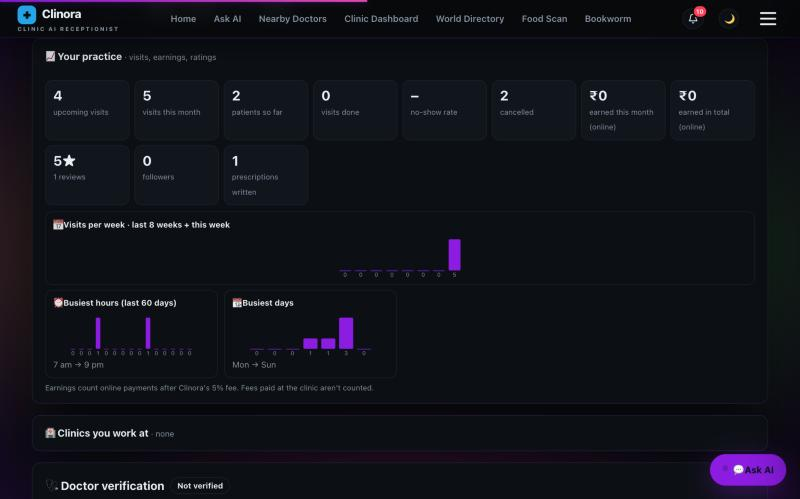
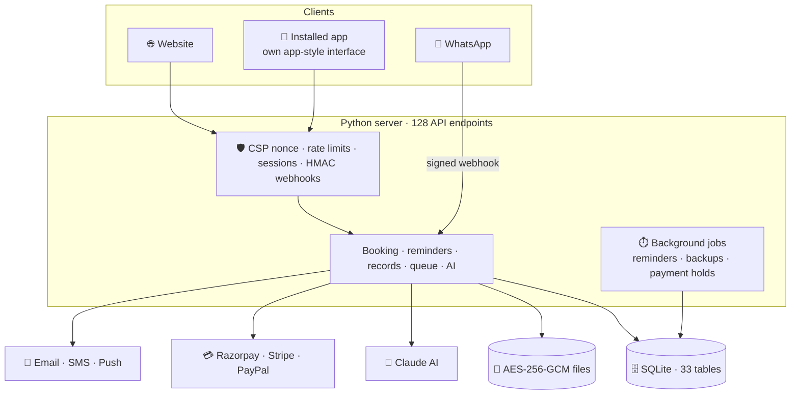
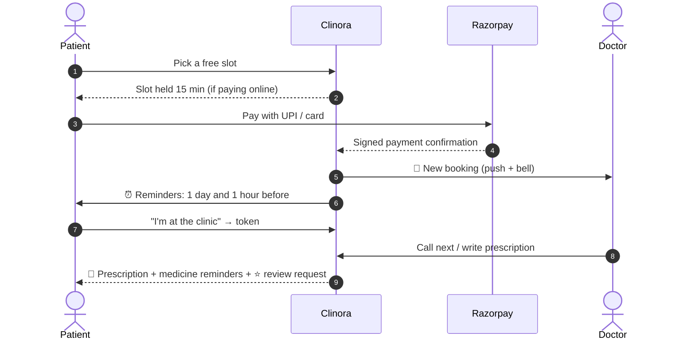

<p align="center"></p>

<h1 align="center">✚ Clinora</h1>
<p align="center"><b>Find and book real doctors, video visits, prescriptions, reminders and encrypted health records, in 139 languages.</b></p>

<p align="center">
  <a href="https://clinora-cwxu.onrender.com"></a>
  <a href="https://github.com/urstrulyrammukesh/clinora/actions/workflows/tests.yml"></a>
  
  
  
  
  
  <a href="https://github.com/urstrulyrammukesh/clinora/actions/workflows/codeql.yml"></a>
  <a href="docs/security-audit.md"></a>
</p>

<p align="center">
  🌐 <a href="https://clinora-cwxu.onrender.com"><b>Open the live demo</b></a> ·
  📄 <a href="docs/Clinora-Company-Overview.pdf"><b>Company paper (PDF)</b></a> ·
  🛠️ <a href="https://github.com/urstrulyrammukesh/clinora-tech-stack"><b>How it's built</b></a> ·
  👤 <a href="https://www.linkedin.com/in/ram-mukesh-yadav-033336412/">Ram Mukesh Yadav</a>, B.Tech CSE, NIT Srinagar
</p>

<p align="center"></p>

> The live demo runs on a free server: it may take ~50 seconds to wake up, and test data resets on restart. The AI does not give medical advice; in an emergency call your local emergency number.

## 📸 Screenshots

<table>
  <tr>
    <td width="62%"><br><sub><b>Website</b>: AI receptionist, map, directory and 139 languages</sub></td>
    <td width="38%" rowspan="2" align="center"><br><sub><b>Installed phone app</b>: app home, next visit, reminders and bottom tabs</sub></td>
  </tr>
  <tr>
    <td><br><sub><b>Book a visit</b>: free slots, clinic or video, who it's for, reason</sub></td>
  </tr>
  <tr>
    <td><br><sub><b>Doctor dashboard</b>: visits, earnings, ratings, busiest hours</sub></td>
    <td><br><sub><b>Doctor's public page</b>: shareable, found by Google</sub></td>
  </tr>
</table>

<sub>Screenshots use sample data (Dr. Sana Mir is a made-up example doctor).</sub>

## 🧭 How it works


## 🏗️ Architecture



## 🔁 A booking, step by step



## 🧊 Clinora logo in 3D

Drag to rotate, scroll to zoom. The model is generated by code: [`assets/3d/make_logo_stl.py`](assets/3d/make_logo_stl.py) → [`clinora-logo.stl`](assets/3d/clinora-logo.stl).

```stl
solid clinora_logo
  facet normal 0.0000 0.7660 0.6428
    outer loop
      vertex 0.000 2.298 1.928
      vertex 12.632 15.305 -13.572
      vertex 11.933 16.064 -14.477
    endloop
  endfacet
  facet normal -0.0000 -0.7660 -0.6428
    outer loop
      vertex 0.000 -0.000 0.000
      vertex 11.933 13.765 -16.405
      vertex 12.632 13.006 -15.500
    endloop
  endfacet
  facet normal 0.8605 0.3274 -0.3902
    outer loop
      vertex 12.632 13.006 -15.500
      vertex 11.933 13.765 -16.405
      vertex 11.933 16.064 -14.477
    endloop
  endfacet
  facet normal 0.8605 0.3274 -0.3902
    outer loop
      vertex 12.632 13.006 -15.500
      vertex 11.933 16.064 -14.477
      vertex 12.632 15.305 -13.572
    endloop
  endfacet
  facet normal -0.0000 0.7660 0.6428
    outer loop
      vertex 0.000 2.298 1.928
      vertex 11.933 16.064 -14.477
      vertex 11.017 16.720 -15.259
    endloop
  endfacet
  facet normal 0.0000 -0.7660 -0.6428
    outer loop
      vertex 0.000 -0.000 0.000
      vertex 11.017 14.422 -17.188
      vertex 11.933 13.765 -16.405
    endloop
  endfacet
  facet normal 0.7446 0.4291 -0.5113
    outer loop
      vertex 11.933 13.765 -16.405
      vertex 11.017 14.422 -17.188
      vertex 11.017 16.720 -15.259
    endloop
  endfacet
  facet normal 0.7446 0.4291 -0.5113
    outer loop
      vertex 11.933 13.765 -16.405
      vertex 11.017 16.720 -15.259
      vertex 11.933 16.064 -14.477
    endloop
  endfacet
  facet normal 0.0000 0.7660 0.6428
    outer loop
      vertex 0.000 2.298 1.928
      vertex 11.017 16.720 -15.259
      vertex 9.919 17.250 -15.890
    endloop
  endfacet
  facet normal 0.0000 -0.7660 -0.6428
    outer loop
      vertex 0.000 -0.000 0.000
      vertex 9.919 14.952 -17.819
      vertex 11.017 14.422 -17.188
    endloop
  endfacet
  facet normal 0.6001 0.5142 -0.6128
    outer loop
      vertex 11.017 14.422 -17.188
      vertex 9.919 14.952 -17.819
      vertex 9.919 17.250 -15.890
    endloop
  endfacet
  facet normal 0.6001 0.5142 -0.6128
    outer loop
      vertex 11.017 14.422 -17.188
      vertex 9.919 17.250 -15.890
      vertex 11.017 16.720 -15.259
    endloop
  endfacet
  facet normal 0.0000 0.7660 0.6428
    outer loop
      vertex 0.000 2.298 1.928
      vertex 9.919 17.250 -15.890
      vertex 8.682 17.631 -16.345
    endloop
  endfacet
  facet normal 0.0000 -0.7660 -0.6428
    outer loop
      vertex 0.000 -0.000 0.000
      vertex 8.682 15.333 -18.273
      vertex 9.919 14.952 -17.819
    endloop
  endfacet
  facet normal 0.4325 0.5796 -0.6907
    outer loop
      vertex 9.919 14.952 -17.819
      vertex 8.682 15.333 -18.273
      vertex 8.682 17.631 -16.345
    endloop
  endfacet
  facet normal 0.4325 0.5796 -0.6907
    outer loop
      vertex 9.919 14.952 -17.819
      vertex 8.682 17.631 -16.345
      vertex 9.919 17.250 -15.890
    endloop
  endfacet
  facet normal 0.0000 0.7660 0.6428
    outer loop
      vertex 0.000 2.298 1.928
      vertex 8.682 17.631 -16.345
      vertex 7.353 17.850 -16.606
    endloop
  endfacet
  facet normal 0.0000 -0.7660 -0.6428
    outer loop
      vertex 0.000 -0.000 0.000
      vertex 7.353 15.552 -18.534
      vertex 8.682 15.333 -18.273
    endloop
  endfacet
  facet normal 0.2483 0.6227 -0.7421
    outer loop
      vertex 8.682 15.333 -18.273
      vertex 7.353 15.552 -18.534
      vertex 7.353 17.850 -16.606
    endloop
  endfacet
  facet normal 0.2483 0.6227 -0.7421
    outer loop
      vertex 8.682 15.333 -18.273
      vertex 7.353 17.850 -16.606
      vertex 8.682 17.631 -16.345
    endloop
  endfacet
  facet normal 0.0000 0.7660 0.6428
    outer loop
      vertex 0.000 2.298 1.928
      vertex 7.353 17.850 -16.606
      vertex 5.983 17.898 -16.663
    endloop
  endfacet
  facet normal -0.0000 -0.7660 -0.6428
    outer loop
      vertex 0.000 -0.000 0.000
      vertex 5.983 15.600 -18.591
      vertex 7.353 15.552 -18.534
    endloop
  endfacet
  facet normal 0.0545 0.6418 -0.7649
    outer loop
      vertex 7.353 15.552 -18.534
      vertex 5.983 15.600 -18.591
      vertex 5.983 17.898 -16.663
    endloop
  endfacet
  facet normal 0.0545 0.6418 -0.7649
    outer loop
      vertex 7.353 15.552 -18.534
      vertex 5.983 17.898 -16.663
      vertex 7.353 17.850 -16.606
    endloop
  endfacet
  facet normal 0.0000 0.7660 0.6428
    outer loop
      vertex 0.000 2.298 1.928
      vertex 5.983 17.898 -16.663
      vertex 4.624 17.774 -16.514
    endloop
  endfacet
  facet normal 0.0000 -0.7660 -0.6428
    outer loop
      vertex 0.000 -0.000 0.000
      vertex 4.624 15.475 -18.443
      vertex 5.983 15.600 -18.591
    endloop
  endfacet
  facet normal -0.1413 0.6363 -0.7584
    outer loop
      vertex 5.983 15.600 -18.591
      vertex 4.624 15.475 -18.443
      vertex 4.624 17.774 -16.514
    endloop
  endfacet
  facet normal -0.1413 0.6363 -0.7584
    outer loop
      vertex 5.983 15.600 -18.591
      vertex 4.624 17.774 -16.514
      vertex 5.983 17.898 -16.663
    endloop
  endfacet
  facet normal 0.0000 0.7660 0.6428
    outer loop
      vertex 0.000 2.298 1.928
      vertex 4.624 17.774 -16.514
      vertex 3.330 17.481 -16.166
    endloop
  endfacet
  facet normal 0.0000 -0.7660 -0.6428
    outer loop
      vertex 0.000 -0.000 0.000
      vertex 3.330 15.183 -18.094
      vertex 4.624 15.475 -18.443
    endloop
  endfacet
  facet normal -0.3317 0.6064 -0.7227
    outer loop
      vertex 4.624 15.475 -18.443
      vertex 3.330 15.183 -18.094
      vertex 3.330 17.481 -16.166
    endloop
  endfacet
  facet normal -0.3317 0.6064 -0.7227
    outer loop
      vertex 4.624 15.475 -18.443
      vertex 3.330 17.481 -16.166
      vertex 4.624 17.774 -16.514
    endloop
  endfacet
  facet normal 0.0000 0.7660 0.6428
    outer loop
      vertex 0.000 2.298 1.928
      vertex 3.330 17.481 -16.166
      vertex -20.234 10.418 -7.748
    endloop
  endfacet
  facet normal 0.0000 -0.7660 -0.6428
    outer loop
      vertex 0.000 -0.000 0.000
      vertex -20.234 8.120 -9.677
      vertex 3.330 15.183 -18.094
    endloop
  endfacet
  facet normal -0.4226 0.5826 -0.6943
    outer loop
      vertex 3.330 15.183 -18.094
      vertex -20.234 8.120 -9.677
      vertex -20.234 10.418 -7.748
    endloop
  endfacet
  facet normal -0.4226 0.5826 -0.6943
    outer loop
      vertex 3.330 15.183 -18.094
      vertex -20.234 10.418 -7.748
      vertex 3.330 17.481 -16.166
    endloop
  endfacet
  facet normal -0.0000 0.7660 0.6428
    outer loop
      vertex 0.000 2.298 1.928
      vertex -20.234 10.418 -7.748
      vertex -21.415 9.969 -7.213
    endloop
  endfacet
  facet normal 0.0000 -0.7660 -0.6428
    outer loop
      vertex 0.000 -0.000 0.000
      vertex -21.415 7.670 -9.141
      vertex -20.234 8.120 -9.677
    endloop
  endfacet
  facet normal -0.5094 0.5531 -0.6592
    outer loop
      vertex -20.234 8.120 -9.677
      vertex -21.415 7.670 -9.141
      vertex -21.415 9.969 -7.213
    endloop
  endfacet
  facet normal -0.5094 0.5531 -0.6592
    outer loop
      vertex -20.234 8.120 -9.677
      vertex -21.415 9.969 -7.213
      vertex -20.234 10.418 -7.748
    endloop
  endfacet
  facet normal 0.0000 0.7660 0.6428
    outer loop
      vertex 0.000 2.298 1.928
      vertex -21.415 9.969 -7.213
      vertex -22.437 9.380 -6.511
    endloop
  endfacet
  facet normal 0.0000 -0.7660 -0.6428
    outer loop
      vertex 0.000 -0.000 0.000
      vertex -22.437 7.082 -8.440
      vertex -21.415 7.670 -9.141
    endloop
  endfacet
  facet normal -0.6675 0.4786 -0.5704
    outer loop
      vertex -21.415 7.670 -9.141
      vertex -22.437 7.082 -8.440
      vertex -22.437 9.380 -6.511
    endloop
  endfacet
  facet normal -0.6675 0.4786 -0.5704
    outer loop
      vertex -21.415 7.670 -9.141
      vertex -22.437 9.380 -6.511
      vertex -21.415 9.969 -7.213
    endloop
  endfacet
  facet normal 0.0000 0.7660 0.6428
    outer loop
      vertex 0.000 2.298 1.928
      vertex -22.437 9.380 -6.511
      vertex -23.260 8.674 -5.670
    endloop
  endfacet
  facet normal 0.0000 -0.7660 -0.6428
    outer loop
      vertex 0.000 -0.000 0.000
      vertex -23.260 6.376 -7.599
      vertex -22.437 7.082 -8.440
    endloop
  endfacet
  facet normal -0.7999 0.3857 -0.4597
    outer loop
      vertex -22.437 7.082 -8.440
      vertex -23.260 6.376 -7.599
      vertex -23.260 8.674 -5.670
    endloop
  endfacet
  facet normal -0.7999 0.3857 -0.4597
    outer loop
      vertex -22.437 7.082 -8.440
      vertex -23.260 8.674 -5.670
      vertex -22.437 9.380 -6.511
    endloop
  endfacet
  facet normal 0.0000 0.7660 0.6428
    outer loop
      vertex 0.000 2.298 1.928
      vertex -23.260 8.674 -5.670
      vertex -23.854 7.879 -4.723
    endloop
  endfacet
  facet normal 0.0000 -0.7660 -0.6428
    outer loop
      vertex 0.000 -0.000 0.000
      vertex -23.854 5.581 -6.651
      vertex -23.260 6.376 -7.599
    endloop
  endfacet
  facet normal -0.9016 0.2780 -0.3313
    outer loop
      vertex -23.260 6.376 -7.599
      vertex -23.854 5.581 -6.651
      vertex -23.854 7.879 -4.723
    endloop
  endfacet
  facet normal -0.9016 0.2780 -0.3313
    outer loop
      vertex -23.260 6.376 -7.599
      vertex -23.854 7.879 -4.723
      vertex -23.260 8.674 -5.670
    endloop
  endfacet
  facet normal -0.0000 0.7660 0.6428
    outer loop
      vertex 0.000 2.298 1.928
      vertex -23.854 7.879 -4.723
      vertex -24.195 7.024 -3.704
    endloop
  endfacet
  facet normal 0.0000 -0.7660 -0.6428
    outer loop
      vertex 0.000 -0.000 0.000
      vertex -24.195 4.726 -5.633
      vertex -23.854 5.581 -6.651
    endloop
  endfacet
  facet normal -0.9687 0.1596 -0.1902
    outer loop
      vertex -23.854 5.581 -6.651
      vertex -24.195 4.726 -5.633
      vertex -24.195 7.024 -3.704
    endloop
  endfacet
  facet normal -0.9687 0.1596 -0.1902
    outer loop
      vertex -23.854 5.581 -6.651
      vertex -24.195 7.024 -3.704
      vertex -23.854 7.879 -4.723
    endloop
  endfacet
  facet normal 0.0000 0.7660 0.6428
    outer loop
      vertex 0.000 2.298 1.928
      vertex -24.195 7.024 -3.704
      vertex -24.269 6.144 -2.655
    endloop
  endfacet
  facet normal 0.0000 -0.7660 -0.6428
    outer loop
      vertex 0.000 -0.000 0.000
      vertex -24.269 3.846 -4.583
      vertex -24.195 4.726 -5.633
    endloop
  endfacet
  facet normal -0.9985 0.0350 -0.0418
    outer loop
      vertex -24.195 4.726 -5.633
      vertex -24.269 3.846 -4.583
      vertex -24.269 6.144 -2.655
    endloop
  endfacet
  facet normal -0.9985 0.0350 -0.0418
    outer loop
      vertex -24.195 4.726 -5.633
      vertex -24.269 6.144 -2.655
      vertex -24.195 7.024 -3.704
    endloop
  endfacet
  facet normal -0.0000 0.7660 0.6428
    outer loop
      vertex 0.000 2.298 1.928
      vertex -24.269 6.144 -2.655
      vertex -24.075 5.270 -1.614
    endloop
  endfacet
  facet normal -0.0000 -0.7660 -0.6428
    outer loop
      vertex 0.000 -0.000 0.000
      vertex -24.075 2.972 -3.542
      vertex -24.269 3.846 -4.583
    endloop
  endfacet
  facet normal -0.9900 -0.0908 0.1083
    outer loop
      vertex -24.269 3.846 -4.583
      vertex -24.075 2.972 -3.542
      vertex -24.075 5.270 -1.614
    endloop
  endfacet
  facet normal -0.9900 -0.0908 0.1083
    outer loop
      vertex -24.269 3.846 -4.583
      vertex -24.075 5.270 -1.614
      vertex -24.269 6.144 -2.655
    endloop
  endfacet
  facet normal 0.0000 0.7660 0.6428
    outer loop
      vertex 0.000 2.298 1.928
      vertex -24.075 5.270 -1.614
      vertex -23.620 4.438 -0.622
    endloop
  endfacet
  facet normal -0.0000 -0.7660 -0.6428
    outer loop
      vertex 0.000 -0.000 0.000
      vertex -23.620 2.140 -2.551
      vertex -24.075 2.972 -3.542
    endloop
  endfacet
  facet normal -0.9434 -0.2132 0.2541
    outer loop
      vertex -24.075 2.972 -3.542
      vertex -23.620 2.140 -2.551
      vertex -23.620 4.438 -0.622
    endloop
  endfacet
  facet normal -0.9434 -0.2132 0.2541
    outer loop
      vertex -24.075 2.972 -3.542
      vertex -23.620 4.438 -0.622
      vertex -24.075 5.270 -1.614
    endloop
  endfacet
  facet normal 0.0000 0.7660 0.6428
    outer loop
      vertex 0.000 2.298 1.928
      vertex -23.620 4.438 -0.622
      vertex -12.632 -10.708 17.429
    endloop
  endfacet
  facet normal -0.0000 -0.7660 -0.6428
    outer loop
      vertex 0.000 -0.000 0.000
      vertex -12.632 -13.006 15.500
      vertex -23.620 2.140 -2.551
    endloop
  endfacet
  facet normal -0.9063 -0.2717 0.3237
    outer loop
      vertex -23.620 2.140 -2.551
      vertex -12.632 -13.006 15.500
      vertex -12.632 -10.708 17.429
    endloop
  endfacet
  facet normal -0.9063 -0.2717 0.3237
    outer loop
      vertex -23.620 2.140 -2.551
      vertex -12.632 -10.708 17.429
      vertex -23.620 4.438 -0.622
    endloop
  endfacet
  facet normal 0.0000 0.7660 0.6428
    outer loop
      vertex 0.000 2.298 1.928
      vertex -12.632 -10.708 17.429
      vertex -11.933 -11.467 18.333
    endloop
  endfacet
  facet normal 0.0000 -0.7660 -0.6428
    outer loop
      vertex 0.000 -0.000 0.000
      vertex -11.933 -13.765 16.405
      vertex -12.632 -13.006 15.500
    endloop
  endfacet
  facet normal -0.8605 -0.3274 0.3902
    outer loop
      vertex -12.632 -13.006 15.500
      vertex -11.933 -13.765 16.405
      vertex -11.933 -11.467 18.333
    endloop
  endfacet
  facet normal -0.8605 -0.3274 0.3902
    outer loop
      vertex -12.632 -13.006 15.500
      vertex -11.933 -11.467 18.333
      vertex -12.632 -10.708 17.429
    endloop
  endfacet
  facet normal -0.0000 0.7660 0.6428
    outer loop
      vertex 0.000 2.298 1.928
      vertex -11.933 -11.467 18.333
      vertex -11.017 -12.124 19.116
    endloop
  endfacet
  facet normal 0.0000 -0.7660 -0.6428
    outer loop
      vertex 0.000 -0.000 0.000
      vertex -11.017 -14.422 17.188
      vertex -11.933 -13.765 16.405
    endloop
  endfacet
  facet normal -0.7446 -0.4291 0.5113
    outer loop
      vertex -11.933 -13.765 16.405
      vertex -11.017 -14.422 17.188
      vertex -11.017 -12.124 19.116
    endloop
  endfacet
  facet normal -0.7446 -0.4291 0.5113
    outer loop
      vertex -11.933 -13.765 16.405
      vertex -11.017 -12.124 19.116
      vertex -11.933 -11.467 18.333
    endloop
  endfacet
  facet normal 0.0000 0.7660 0.6428
    outer loop
      vertex 0.000 2.298 1.928
      vertex -11.017 -12.124 19.116
      vertex -9.919 -12.653 19.747
    endloop
  endfacet
  facet normal 0.0000 -0.7660 -0.6428
    outer loop
      vertex 0.000 -0.000 0.000
      vertex -9.919 -14.952 17.819
      vertex -11.017 -14.422 17.188
    endloop
  endfacet
  facet normal -0.6001 -0.5142 0.6128
    outer loop
      vertex -11.017 -14.422 17.188
      vertex -9.919 -14.952 17.819
      vertex -9.919 -12.653 19.747
    endloop
  endfacet
  facet normal -0.6001 -0.5142 0.6128
    outer loop
      vertex -11.017 -14.422 17.188
      vertex -9.919 -12.653 19.747
      vertex -11.017 -12.124 19.116
    endloop
  endfacet
  facet normal 0.0000 0.7660 0.6428
    outer loop
      vertex 0.000 2.298 1.928
      vertex -9.919 -12.653 19.747
      vertex -8.682 -13.035 20.202
    endloop
  endfacet
  facet normal 0.0000 -0.7660 -0.6428
    outer loop
      vertex 0.000 -0.000 0.000
      vertex -8.682 -15.333 18.273
      vertex -9.919 -14.952 17.819
    endloop
  endfacet
  facet normal -0.4325 -0.5796 0.6907
    outer loop
      vertex -9.919 -14.952 17.819
      vertex -8.682 -15.333 18.273
      vertex -8.682 -13.035 20.202
    endloop
  endfacet
  facet normal -0.4325 -0.5796 0.6907
    outer loop
      vertex -9.919 -14.952 17.819
      vertex -8.682 -13.035 20.202
      vertex -9.919 -12.653 19.747
    endloop
  endfacet
  facet normal 0.0000 0.7660 0.6428
    outer loop
      vertex 0.000 2.298 1.928
      vertex -8.682 -13.035 20.202
      vertex -7.353 -13.254 20.462
    endloop
  endfacet
  facet normal 0.0000 -0.7660 -0.6428
    outer loop
      vertex 0.000 -0.000 0.000
      vertex -7.353 -15.552 18.534
      vertex -8.682 -15.333 18.273
    endloop
  endfacet
  facet normal -0.2483 -0.6227 0.7421
    outer loop
      vertex -8.682 -15.333 18.273
      vertex -7.353 -15.552 18.534
      vertex -7.353 -13.254 20.462
    endloop
  endfacet
  facet normal -0.2483 -0.6227 0.7421
    outer loop
      vertex -8.682 -15.333 18.273
      vertex -7.353 -13.254 20.462
      vertex -8.682 -13.035 20.202
    endloop
  endfacet
  facet normal 0.0000 0.7660 0.6428
    outer loop
      vertex 0.000 2.298 1.928
      vertex -7.353 -13.254 20.462
      vertex -5.983 -13.302 20.520
    endloop
  endfacet
  facet normal -0.0000 -0.7660 -0.6428
    outer loop
      vertex 0.000 -0.000 0.000
      vertex -5.983 -15.600 18.591
      vertex -7.353 -15.552 18.534
    endloop
  endfacet
  facet normal -0.0545 -0.6418 0.7649
    outer loop
      vertex -7.353 -15.552 18.534
      vertex -5.983 -15.600 18.591
      vertex -5.983 -13.302 20.520
    endloop
  endfacet
  facet normal -0.0545 -0.6418 0.7649
    outer loop
      vertex -7.353 -15.552 18.534
      vertex -5.983 -13.302 20.520
      vertex -7.353 -13.254 20.462
    endloop
  endfacet
  facet normal 0.0000 0.7660 0.6428
    outer loop
      vertex 0.000 2.298 1.928
      vertex -5.983 -13.302 20.520
      vertex -4.624 -13.177 20.371
    endloop
  endfacet
  facet normal 0.0000 -0.7660 -0.6428
    outer loop
      vertex 0.000 -0.000 0.000
      vertex -4.624 -15.475 18.443
      vertex -5.983 -15.600 18.591
    endloop
  endfacet
  facet normal 0.1413 -0.6363 0.7584
    outer loop
      vertex -5.983 -15.600 18.591
      vertex -4.624 -15.475 18.443
      vertex -4.624 -13.177 20.371
    endloop
  endfacet
  facet normal 0.1413 -0.6363 0.7584
    outer loop
      vertex -5.983 -15.600 18.591
      vertex -4.624 -13.177 20.371
      vertex -5.983 -13.302 20.520
    endloop
  endfacet
  facet normal -0.0000 0.7660 0.6428
    outer loop
      vertex 0.000 2.298 1.928
      vertex -4.624 -13.177 20.371
      vertex -3.330 -12.885 20.022
    endloop
  endfacet
  facet normal 0.0000 -0.7660 -0.6428
    outer loop
      vertex 0.000 -0.000 0.000
      vertex -3.330 -15.183 18.094
      vertex -4.624 -15.475 18.443
    endloop
  endfacet
  facet normal 0.3317 -0.6064 0.7227
    outer loop
      vertex -4.624 -15.475 18.443
      vertex -3.330 -15.183 18.094
      vertex -3.330 -12.885 20.022
    endloop
  endfacet
  facet normal 0.3317 -0.6064 0.7227
    outer loop
      vertex -4.624 -15.475 18.443
      vertex -3.330 -12.885 20.022
      vertex -4.624 -13.177 20.371
    endloop
  endfacet
  facet normal 0.0000 0.7660 0.6428
    outer loop
      vertex 0.000 2.298 1.928
      vertex -3.330 -12.885 20.022
      vertex 20.234 -5.822 11.605
    endloop
  endfacet
  facet normal 0.0000 -0.7660 -0.6428
    outer loop
      vertex 0.000 -0.000 0.000
      vertex 20.234 -8.120 9.677
      vertex -3.330 -15.183 18.094
    endloop
  endfacet
  facet normal 0.4226 -0.5826 0.6943
    outer loop
      vertex -3.330 -15.183 18.094
      vertex 20.234 -8.120 9.677
      vertex 20.234 -5.822 11.605
    endloop
  endfacet
  facet normal 0.4226 -0.5826 0.6943
    outer loop
      vertex -3.330 -15.183 18.094
      vertex 20.234 -5.822 11.605
      vertex -3.330 -12.885 20.022
    endloop
  endfacet
  facet normal 0.0000 0.7660 0.6428
    outer loop
      vertex 0.000 2.298 1.928
      vertex 20.234 -5.822 11.605
      vertex 21.415 -5.372 11.070
    endloop
  endfacet
  facet normal 0.0000 -0.7660 -0.6428
    outer loop
      vertex 0.000 -0.000 0.000
      vertex 21.415 -7.670 9.141
      vertex 20.234 -8.120 9.677
    endloop
  endfacet
  facet normal 0.5094 -0.5531 0.6592
    outer loop
      vertex 20.234 -8.120 9.677
      vertex 21.415 -7.670 9.141
      vertex 21.415 -5.372 11.070
    endloop
  endfacet
  facet normal 0.5094 -0.5531 0.6592
    outer loop
      vertex 20.234 -8.120 9.677
      vertex 21.415 -5.372 11.070
      vertex 20.234 -5.822 11.605
    endloop
  endfacet
  facet normal 0.0000 0.7660 0.6428
    outer loop
      vertex 0.000 2.298 1.928
      vertex 21.415 -5.372 11.070
      vertex 22.437 -4.784 10.368
    endloop
  endfacet
  facet normal 0.0000 -0.7660 -0.6428
    outer loop
      vertex 0.000 -0.000 0.000
      vertex 22.437 -7.082 8.440
      vertex 21.415 -7.670 9.141
    endloop
  endfacet
  facet normal 0.6675 -0.4786 0.5704
    outer loop
      vertex 21.415 -7.670 9.141
      vertex 22.437 -7.082 8.440
      vertex 22.437 -4.784 10.368
    endloop
  endfacet
  facet normal 0.6675 -0.4786 0.5704
    outer loop
      vertex 21.415 -7.670 9.141
      vertex 22.437 -4.784 10.368
      vertex 21.415 -5.372 11.070
    endloop
  endfacet
  facet normal -0.0000 0.7660 0.6428
    outer loop
      vertex 0.000 2.298 1.928
      vertex 22.437 -4.784 10.368
      vertex 23.260 -4.078 9.527
    endloop
  endfacet
  facet normal -0.0000 -0.7660 -0.6428
    outer loop
      vertex 0.000 -0.000 0.000
      vertex 23.260 -6.376 7.599
      vertex 22.437 -7.082 8.440
    endloop
  endfacet
  facet normal 0.7999 -0.3857 0.4597
    outer loop
      vertex 22.437 -7.082 8.440
      vertex 23.260 -6.376 7.599
      vertex 23.260 -4.078 9.527
    endloop
  endfacet
  facet normal 0.7999 -0.3857 0.4597
    outer loop
      vertex 22.437 -7.082 8.440
      vertex 23.260 -4.078 9.527
      vertex 22.437 -4.784 10.368
    endloop
  endfacet
  facet normal 0.0000 0.7660 0.6428
    outer loop
      vertex 0.000 2.298 1.928
      vertex 23.260 -4.078 9.527
      vertex 23.854 -3.283 8.579
    endloop
  endfacet
  facet normal 0.0000 -0.7660 -0.6428
    outer loop
      vertex 0.000 -0.000 0.000
      vertex 23.854 -5.581 6.651
      vertex 23.260 -6.376 7.599
    endloop
  endfacet
  facet normal 0.9016 -0.2780 0.3313
    outer loop
      vertex 23.260 -6.376 7.599
      vertex 23.854 -5.581 6.651
      vertex 23.854 -3.283 8.579
    endloop
  endfacet
  facet normal 0.9016 -0.2780 0.3313
    outer loop
      vertex 23.260 -6.376 7.599
      vertex 23.854 -3.283 8.579
      vertex 23.260 -4.078 9.527
    endloop
  endfacet
  facet normal -0.0000 0.7660 0.6428
    outer loop
      vertex 0.000 2.298 1.928
      vertex 23.854 -3.283 8.579
      vertex 24.195 -2.428 7.561
    endloop
  endfacet
  facet normal 0.0000 -0.7660 -0.6428
    outer loop
      vertex 0.000 -0.000 0.000
      vertex 24.195 -4.726 5.633
      vertex 23.854 -5.581 6.651
    endloop
  endfacet
  facet normal 0.9687 -0.1596 0.1902
    outer loop
      vertex 23.854 -5.581 6.651
      vertex 24.195 -4.726 5.633
      vertex 24.195 -2.428 7.561
    endloop
  endfacet
  facet normal 0.9687 -0.1596 0.1902
    outer loop
      vertex 23.854 -5.581 6.651
      vertex 24.195 -2.428 7.561
      vertex 23.854 -3.283 8.579
    endloop
  endfacet
  facet normal -0.0000 0.7660 0.6428
    outer loop
      vertex 0.000 2.298 1.928
      vertex 24.195 -2.428 7.561
      vertex 24.269 -1.547 6.511
    endloop
  endfacet
  facet normal 0.0000 -0.7660 -0.6428
    outer loop
      vertex 0.000 -0.000 0.000
      vertex 24.269 -3.846 4.583
      vertex 24.195 -4.726 5.633
    endloop
  endfacet
  facet normal 0.9985 -0.0350 0.0418
    outer loop
      vertex 24.195 -4.726 5.633
      vertex 24.269 -3.846 4.583
      vertex 24.269 -1.547 6.511
    endloop
  endfacet
  facet normal 0.9985 -0.0350 0.0418
    outer loop
      vertex 24.195 -4.726 5.633
      vertex 24.269 -1.547 6.511
      vertex 24.195 -2.428 7.561
    endloop
  endfacet
  facet normal 0.0000 0.7660 0.6428
    outer loop
      vertex 0.000 2.298 1.928
      vertex 24.269 -1.547 6.511
      vertex 24.075 -0.674 5.471
    endloop
  endfacet
  facet normal 0.0000 -0.7660 -0.6428
    outer loop
      vertex 0.000 -0.000 0.000
      vertex 24.075 -2.972 3.542
      vertex 24.269 -3.846 4.583
    endloop
  endfacet
  facet normal 0.9900 0.0908 -0.1083
    outer loop
      vertex 24.269 -3.846 4.583
      vertex 24.075 -2.972 3.542
      vertex 24.075 -0.674 5.471
    endloop
  endfacet
  facet normal 0.9900 0.0908 -0.1083
    outer loop
      vertex 24.269 -3.846 4.583
      vertex 24.075 -0.674 5.471
      vertex 24.269 -1.547 6.511
    endloop
  endfacet
  facet normal 0.0000 0.7660 0.6428
    outer loop
      vertex 0.000 2.298 1.928
      vertex 24.075 -0.674 5.471
      vertex 23.620 0.158 4.479
    endloop
  endfacet
  facet normal 0.0000 -0.7660 -0.6428
    outer loop
      vertex 0.000 -0.000 0.000
      vertex 23.620 -2.140 2.551
      vertex 24.075 -2.972 3.542
    endloop
  endfacet
  facet normal 0.9434 0.2132 -0.2541
    outer loop
      vertex 24.075 -2.972 3.542
      vertex 23.620 -2.140 2.551
      vertex 23.620 0.158 4.479
    endloop
  endfacet
  facet normal 0.9434 0.2132 -0.2541
    outer loop
      vertex 24.075 -2.972 3.542
      vertex 23.620 0.158 4.479
      vertex 24.075 -0.674 5.471
    endloop
  endfacet
  facet normal -0.0000 0.7660 0.6428
    outer loop
      vertex 0.000 2.298 1.928
      vertex 23.620 0.158 4.479
      vertex 12.632 15.305 -13.572
    endloop
  endfacet
  facet normal 0.0000 -0.7660 -0.6428
    outer loop
      vertex 0.000 -0.000 0.000
      vertex 12.632 13.006 -15.500
      vertex 23.620 -2.140 2.551
    endloop
  endfacet
  facet normal 0.9063 0.2717 -0.3237
    outer loop
      vertex 23.620 -2.140 2.551
      vertex 12.632 13.006 -15.500
      vertex 12.632 15.305 -13.572
    endloop
  endfacet
  facet normal 0.9063 0.2717 -0.3237
    outer loop
      vertex 23.620 -2.140 2.551
      vertex 12.632 15.305 -13.572
      vertex 23.620 0.158 4.479
    endloop
  endfacet
  facet normal 0.9063 0.2717 -0.3237
    outer loop
      vertex 11.324 -6.095 9.598
      vertex 7.309 -0.561 3.002
      vertex 7.309 9.015 11.037
    endloop
  endfacet
  facet normal 0.9063 0.2717 -0.3237
    outer loop
      vertex 11.324 -6.095 9.598
      vertex 7.309 9.015 11.037
      vertex 11.324 3.480 17.633
    endloop
  endfacet
  facet normal 0.4226 -0.5826 0.6943
    outer loop
      vertex 7.309 -0.561 3.002
      vertex 15.919 2.020 -0.073
      vertex 15.919 11.595 7.961
    endloop
  endfacet
  facet normal 0.4226 -0.5826 0.6943
    outer loop
      vertex 7.309 -0.561 3.002
      vertex 15.919 11.595 7.961
      vertex 7.309 9.015 11.037
    endloop
  endfacet
  facet normal 0.9063 0.2717 -0.3237
    outer loop
      vertex 15.919 2.020 -0.073
      vertex 11.270 8.428 -7.710
      vertex 11.270 18.004 0.324
    endloop
  endfacet
  facet normal 0.9063 0.2717 -0.3237
    outer loop
      vertex 15.919 2.020 -0.073
      vertex 11.270 18.004 0.324
      vertex 15.919 11.595 7.961
    endloop
  endfacet
  facet normal -0.4226 0.5826 -0.6943
    outer loop
      vertex 11.270 8.428 -7.710
      vertex 2.660 5.847 -4.635
      vertex 2.660 15.423 3.400
    endloop
  endfacet
  facet normal -0.4226 0.5826 -0.6943
    outer loop
      vertex 11.270 8.428 -7.710
      vertex 2.660 15.423 3.400
      vertex 11.270 18.004 0.324
    endloop
  endfacet
  facet normal 0.9063 0.2717 -0.3237
    outer loop
      vertex 2.660 5.847 -4.635
      vertex -1.355 11.382 -11.230
      vertex -1.355 20.957 -3.196
    endloop
  endfacet
  facet normal 0.9063 0.2717 -0.3237
    outer loop
      vertex 2.660 5.847 -4.635
      vertex -1.355 20.957 -3.196
      vertex 2.660 15.423 3.400
    endloop
  endfacet
  facet normal -0.4226 0.5826 -0.6943
    outer loop
      vertex -1.355 11.382 -11.230
      vertex -11.324 8.393 -7.669
      vertex -11.324 17.969 0.366
    endloop
  endfacet
  facet normal -0.4226 0.5826 -0.6943
    outer loop
      vertex -1.355 11.382 -11.230
      vertex -11.324 17.969 0.366
      vertex -1.355 20.957 -3.196
    endloop
  endfacet
  facet normal -0.9063 -0.2717 0.3237
    outer loop
      vertex -11.324 8.393 -7.669
      vertex -7.309 2.859 -1.074
      vertex -7.309 12.435 6.961
    endloop
  endfacet
  facet normal -0.9063 -0.2717 0.3237
    outer loop
      vertex -11.324 8.393 -7.669
      vertex -7.309 12.435 6.961
      vertex -11.324 17.969 0.366
    endloop
  endfacet
  facet normal -0.4226 0.5826 -0.6943
    outer loop
      vertex -7.309 2.859 -1.074
      vertex -15.919 0.278 2.002
      vertex -15.919 9.854 10.037
    endloop
  endfacet
  facet normal -0.4226 0.5826 -0.6943
    outer loop
      vertex -7.309 2.859 -1.074
      vertex -15.919 9.854 10.037
      vertex -7.309 12.435 6.961
    endloop
  endfacet
  facet normal -0.9063 -0.2717 0.3237
    outer loop
      vertex -15.919 0.278 2.002
      vertex -11.270 -6.130 9.639
      vertex -11.270 3.446 17.674
    endloop
  endfacet
  facet normal -0.9063 -0.2717 0.3237
    outer loop
      vertex -15.919 0.278 2.002
      vertex -11.270 3.446 17.674
      vertex -15.919 9.854 10.037
    endloop
  endfacet
  facet normal 0.4226 -0.5826 0.6943
    outer loop
      vertex -11.270 -6.130 9.639
      vertex -2.660 -3.549 6.563
      vertex -2.660 6.026 14.598
    endloop
  endfacet
  facet normal 0.4226 -0.5826 0.6943
    outer loop
      vertex -11.270 -6.130 9.639
      vertex -2.660 6.026 14.598
      vertex -11.270 3.446 17.674
    endloop
  endfacet
  facet normal -0.9063 -0.2717 0.3237
    outer loop
      vertex -2.660 -3.549 6.563
      vertex 1.355 -9.083 13.159
      vertex 1.355 0.492 21.194
    endloop
  endfacet
  facet normal -0.9063 -0.2717 0.3237
    outer loop
      vertex -2.660 -3.549 6.563
      vertex 1.355 0.492 21.194
      vertex -2.660 6.026 14.598
    endloop
  endfacet
  facet normal 0.4226 -0.5826 0.6943
    outer loop
      vertex 1.355 -9.083 13.159
      vertex 11.324 -6.095 9.598
      vertex 11.324 3.480 17.633
    endloop
  endfacet
  facet normal 0.4226 -0.5826 0.6943
    outer loop
      vertex 1.355 -9.083 13.159
      vertex 11.324 3.480 17.633
      vertex 1.355 0.492 21.194
    endloop
  endfacet
  facet normal 0.0000 0.7660 0.6428
    outer loop
      vertex -2.660 6.026 14.598
      vertex 7.309 9.015 11.037
      vertex 2.660 15.423 3.400
    endloop
  endfacet
  facet normal 0.0000 0.7660 0.6428
    outer loop
      vertex -2.660 6.026 14.598
      vertex 2.660 15.423 3.400
      vertex -7.309 12.435 6.961
    endloop
  endfacet
  facet normal -0.0000 0.7660 0.6428
    outer loop
      vertex -7.309 12.435 6.961
      vertex 2.660 15.423 3.400
      vertex -1.355 20.957 -3.196
    endloop
  endfacet
  facet normal 0.0000 0.7660 0.6428
    outer loop
      vertex -7.309 12.435 6.961
      vertex -1.355 20.957 -3.196
      vertex -11.324 17.969 0.366
    endloop
  endfacet
  facet normal 0.0000 0.7660 0.6428
    outer loop
      vertex 1.355 0.492 21.194
      vertex 11.324 3.480 17.633
      vertex 7.309 9.015 11.037
    endloop
  endfacet
  facet normal -0.0000 0.7660 0.6428
    outer loop
      vertex 1.355 0.492 21.194
      vertex 7.309 9.015 11.037
      vertex -2.660 6.026 14.598
    endloop
  endfacet
  facet normal -0.0000 0.7660 0.6428
    outer loop
      vertex 7.309 9.015 11.037
      vertex 15.919 11.595 7.961
      vertex 11.270 18.004 0.324
    endloop
  endfacet
  facet normal 0.0000 0.7660 0.6428
    outer loop
      vertex 7.309 9.015 11.037
      vertex 11.270 18.004 0.324
      vertex 2.660 15.423 3.400
    endloop
  endfacet
  facet normal 0.0000 0.7660 0.6428
    outer loop
      vertex -11.270 3.446 17.674
      vertex -2.660 6.026 14.598
      vertex -7.309 12.435 6.961
    endloop
  endfacet
  facet normal 0.0000 0.7660 0.6428
    outer loop
      vertex -11.270 3.446 17.674
      vertex -7.309 12.435 6.961
      vertex -15.919 9.854 10.037
    endloop
  endfacet
endsolid clinora_logo
```

## 📍 Where Clinora is built

```geojson
{
  "type": "FeatureCollection",
  "features": [
    {"type": "Feature", "properties": {"name": "Clinora", "description": "Built and launching in Srinagar, Jammu & Kashmir, India", "marker-color": "#14b8a6", "marker-symbol": "hospital"},
     "geometry": {"type": "Point", "coordinates": [74.7973, 34.0837]}},
    {"type": "Feature", "properties": {"name": "NIT Srinagar", "description": "Where the founder studies B.Tech Computer Science & Engineering", "marker-color": "#2563eb", "marker-symbol": "college"},
     "geometry": {"type": "Point", "coordinates": [74.8370, 34.1260]}}
  ]
}
```

## Features
- 💬 **AI chat panel** on every page (Claude): bookings, cancellations, fees, emergencies, worldwide directory search
- 🌍 **139 languages**: 9 hand-translated, the rest translated by AI once and saved; right-to-left support
- 📍 **Nearby doctors** on a 3D map with open/closed status and local emergency numbers
- 🗂️ **World directory**: hospitals, clinics, doctors, dentists, pharmacies, labs, universities and medical colleges (OpenStreetMap data)
- 📹 **Video consultations** (browser-to-browser WebRTC)
- 💳 **Payments** in 52 currencies: UPI / Paytm / Google Pay (Razorpay), cards / Apple Pay / Google Pay (Stripe), PayPal. Runs in demo mode until keys are added
- 🚕 **Ride booking** links per country (Uber, Ola, Rapido, Lyft, Careem, Grab, Bolt…)
- 🔒 **Clinic dashboard** with admin and doctor roles, hashed passwords, private patient data
- 🎛️ **Style panel**: motion level, colours, font and text size
- 👤 **Patient and doctor accounts**: follow favourite doctors, see who is online now, private messages; doctors edit their own profile (Instagram, Telegram, WhatsApp, Facebook, YouTube, LinkedIn)
- 🎓 **University doctors**: AI search of official websites (AIIMS, IIT and NIT hospitals, medical colleges) with a source link for every name
- 📮 **PIN / ZIP code search** in the directory and on the map
- 🧍 **Live map**: you appear as a person that walks, runs or drives as you move (GPS + motion sensor)
- ☎️ **Helplines per country**: emergency, women and harassment, suicide and emotional support, children
- 📹 **WhatsApp-style video calls** between patients and doctors, with a ringing screen (Accept / Decline)
- 🍔 **Food Scan**: photograph any food or packet label and the AI says if it's OK for you (allergies, conditions, diet), with calories and a healthier swap
- 📚 **Bookworm**: free medical books (Open Library, Google Books, OpenStax, NCBI, WHO and more)

## New for doctors and patients
- 📱 **Phone app interface**: the installed app opens with a splash screen, an app home and bottom tabs (the website stays a website)
- 📅 **Book real doctors**: free slots, video or in-clinic, online payment (Razorpay Route split), automatic refunds
- 📹 **Visit flow**: Join button for video visits, printable prescriptions, one-tap medicine reminders, review requests, receipts
- 🎫 **Clinic queue tokens** with turn alerts, a **live tracking link** (no login) and a waiting-room TV screen
- 🗂 **Patient history for doctors** (visits, diagnoses, medicines, shared reports, private notes) and **busiest hours** charts
- 🏥 **Clinics with several doctors**, a **doctor dashboard**, **invite links** and **5 page designs** for doctor pages
- 📁 **Encrypted health records**, shared with one doctor for one visit
- ⏰ **Reminders** by bell, phone push, email, SMS and WhatsApp; 📷 prescription photo → reminders; 💊 cheaper generic medicines
- 💬 **Clinora on WhatsApp**, 🎤 **voice input**, 👨‍👩‍👧 **family members**
- ⚡ **Light mode on phones**, smaller images, gzip, strict CSP, 49 automated tests
- 🗺️ **Smarter map**: exact GPS with accuracy circle, follow-me with compass, routes with travel times (walk, cycle, bike, car, bus, train, flight), search doctors and hospitals by name
- 📡 **Live location sharing**: a private link family can follow, with travel mode and speed; SOS shares it automatically
- 🌍 **Visitor statistics** for the admin: visitors per day, countries, devices, where they came from, app installs (anonymous)
- ☁️ **Keeps data on free hosting**: last backup to the cloud when the server stops, automatic restore on an empty disk

## 🛡️ Security

Clinora handles health data, so security is built in and **tested**:

- 🔍 **[Security audit](docs/security-audit.md)**: Bandit, pip-audit, CodeQL and hand checks on the live site. 9 findings, all fixed or explained, each locked in by a test.
- 🧠 **[Threat model (STRIDE)](docs/threat-model.md)**: who might attack, what they'd go after, and which layer stops them.
- ⚙️ **Every push** runs the tests, CodeQL, Bandit and pip-audit; Dependabot keeps packages up to date.
- 🛡️ **Two-factor login** for clinic staff: authenticator app (QR code), one-time recovery codes, replay and brute-force protection.
- 🔒 Strict CSP with per-page nonce · exact-file script allow-list with SRI · PBKDF2 passwords · HttpOnly cookies · rate limits (incl. AI chat) · HMAC webhooks · AES-256-GCM records · anonymous visit counts (no cookies, no IPs).
- 📮 Found something? **[Report it privately](SECURITY.md)**.

## Put it live
Step-by-step: **[docs/go-live.md](docs/go-live.md)** (Render + your own domain, about 1–2 hours). Check readiness any time with `python server.py --check`.

## Tests
The `tests/` folder starts a real Clinora server with an empty database and checks accounts, email confirmation, password reset, booking, reminders, verification, reports, blocking, push notifications, backups, statistics, security headers and the live-site safeguards.
```bash
pip install -r requirements.txt pytest
pytest -q tests
```
GitHub runs them on every push (see the badge above), measures coverage, and scans with Bandit and pip-audit. Want to help? See **[CONTRIBUTING.md](CONTRIBUTING.md)**.

## Run it on your computer (macOS)
1. Double-click **`start.command`**. The first run sets everything up.
2. Open **http://localhost:8765**

Or from a terminal:
```bash
python3 -m venv .venv && .venv/bin/pip install -r requirements.txt
.venv/bin/python server.py
```

## Keys (optional)
Copy `.env.example` to `.env` and add your own keys. **Never commit `.env`.**
- `ANTHROPIC_API_KEY`: turns on the real AI chat and AI translations
- `STRIPE_SECRET_KEY`, `RAZORPAY_KEY_ID` / `RAZORPAY_KEY_SECRET`, `PAYPAL_CLIENT_ID` / `PAYPAL_CLIENT_SECRET`: real payments (use test keys first)

Without keys, the site runs with simple built-in chat replies and demo payments.

## Files
| File | What it is |
|---|---|
| `index.html` | The whole website |
| `i18n.js` | Translations and the language list |
| `server.py` | Web server, AI, database (SQLite), logins, payments, video-call signalling |
| `data/` | Database and saved AI translations (the database is not uploaded) |
| `assets/` | Images |

## Going live (website, Google, Play Store)
Step-by-step guide: **`docs/play-store/README.md`**. Hosting is set up for Render in `render.yaml`. Privacy, Terms and Delete-account pages are in `legal/` and appear at `/privacy`, `/terms` and `/delete-account`.
