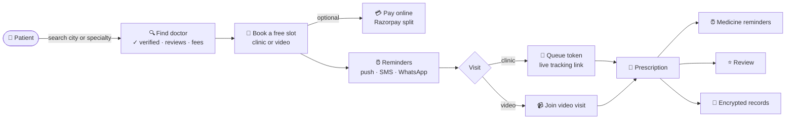
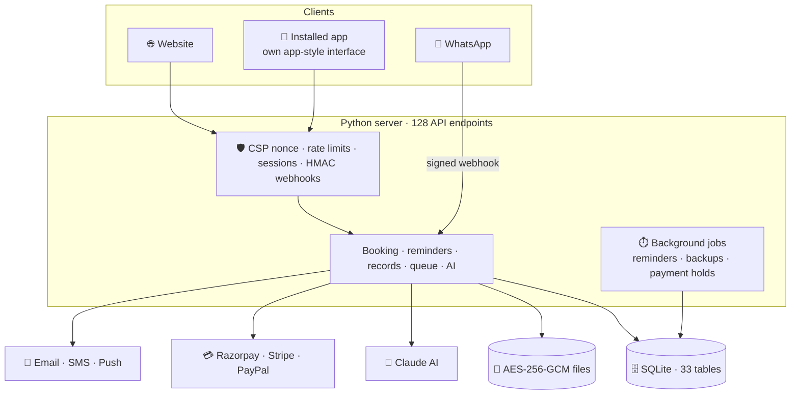
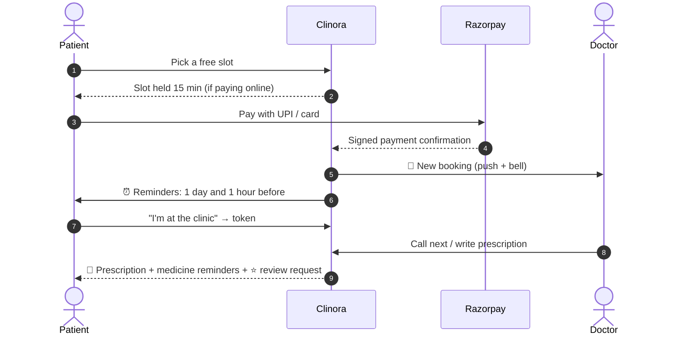

<p align="center"></p>

<h1 align="center">✚ Clinora</h1>
<p align="center"><b>Find and book real doctors, video visits, prescriptions, reminders and encrypted health records, in 139 languages.</b></p>

<p align="center">
  <a href="https://clinora-cwxu.onrender.com"></a>
  <a href="https://github.com/urstrulyrammukesh/clinora/actions/workflows/tests.yml"></a>
  
  
  
  
  
</p>

<p align="center">
  🌐 <a href="https://clinora-cwxu.onrender.com"><b>Open the live demo</b></a> ·
  📄 <a href="docs/Clinora-Company-Overview.pdf"><b>Company paper (PDF)</b></a> ·
  🛠️ <a href="https://github.com/urstrulyrammukesh/clinora-tech-stack"><b>How it's built</b></a> ·
  👤 <a href="https://www.linkedin.com/in/ram-mukesh-yadav-033336412/">Ram Mukesh Yadav</a>, B.Tech CSE, NIT Srinagar
</p>

> The live demo runs on a free server: it may take ~50 seconds to wake up, and test data resets on restart. The AI does not give medical advice; in an emergency call your local emergency number.

## 🧭 How it works



## 🏗️ Architecture



## 🔁 A booking, step by step



## Features
- 💬 **AI chat panel** on every page (Claude): bookings, cancellations, fees, emergencies, worldwide directory search
- 🌍 **139 languages**: 9 hand-translated, the rest translated by AI once and saved; right-to-left support
- 📍 **Nearby doctors** on a 3D map with open/closed status and local emergency numbers
- 🗂️ **World directory**: hospitals, clinics, doctors, dentists, pharmacies, labs, universities and medical colleges (OpenStreetMap data)
- 📹 **Video consultations** (browser-to-browser WebRTC)
- 💳 **Payments** in 52 currencies: UPI / Paytm / Google Pay (Razorpay), cards / Apple Pay / Google Pay (Stripe), PayPal. Runs in demo mode until keys are added
- 🚕 **Ride booking** links per country (Uber, Ola, Rapido, Lyft, Careem, Grab, Bolt…)
- 🔒 **Clinic dashboard** with admin and doctor roles, hashed passwords, private patient data
- 🎛️ **Style panel**: motion level, colours, font and text size
- 👤 **Patient and doctor accounts**: follow favourite doctors, see who is online now, private messages; doctors edit their own profile (Instagram, Telegram, WhatsApp, Facebook, YouTube, LinkedIn)
- 🎓 **University doctors**: AI search of official websites (AIIMS, IIT and NIT hospitals, medical colleges) with a source link for every name
- 📮 **PIN / ZIP code search** in the directory and on the map
- 🧍 **Live map**: you appear as a person that walks, runs or drives as you move (GPS + motion sensor)
- ☎️ **Helplines per country**: emergency, women and harassment, suicide and emotional support, children
- 📹 **WhatsApp-style video calls** between patients and doctors, with a ringing screen (Accept / Decline)
- 🍔 **Food Scan**: photograph any food or packet label and the AI says if it's OK for you (allergies, conditions, diet), with calories and a healthier swap
- 📚 **Bookworm**: free medical books (Open Library, Google Books, OpenStax, NCBI, WHO and more)

## New for doctors and patients
- 📱 **Phone app interface**: the installed app opens with a splash screen, an app home and bottom tabs (the website stays a website)
- 📅 **Book real doctors**: free slots, video or in-clinic, online payment (Razorpay Route split), automatic refunds
- 📹 **Visit flow**: Join button for video visits, printable prescriptions, one-tap medicine reminders, review requests, receipts
- 🎫 **Clinic queue tokens** with turn alerts, a **live tracking link** (no login) and a waiting-room TV screen
- 🗂 **Patient history for doctors** (visits, diagnoses, medicines, shared reports, private notes) and **busiest hours** charts
- 🏥 **Clinics with several doctors**, a **doctor dashboard**, **invite links** and **5 page designs** for doctor pages
- 📁 **Encrypted health records**, shared with one doctor for one visit
- ⏰ **Reminders** by bell, phone push, email, SMS and WhatsApp; 📷 prescription photo → reminders; 💊 cheaper generic medicines
- 💬 **Clinora on WhatsApp**, 🎤 **voice input**, 👨‍👩‍👧 **family members**
- ⚡ **Light mode on phones**, smaller images, gzip, strict CSP, 33 automated test groups

## Put it live
Step-by-step: **[docs/go-live.md](docs/go-live.md)** (Render + your own domain, about 1–2 hours). Check readiness any time with `python server.py --check`.

## Tests
The `tests/` folder starts a real Clinora server with an empty database and checks accounts, email confirmation, password reset, booking, reminders, verification, reports, blocking, push notifications, backups, statistics, security headers and the live-site safeguards.
```bash
pip install -r requirements.txt pytest
pytest -q tests
```
GitHub runs them on every push (see the badge above).

## Run it on your computer (macOS)
1. Double-click **`start.command`**. The first run sets everything up.
2. Open **http://localhost:8765**

Or from a terminal:
```bash
python3 -m venv .venv && .venv/bin/pip install -r requirements.txt
.venv/bin/python server.py
```

## Keys (optional)
Copy `.env.example` to `.env` and add your own keys. **Never commit `.env`.**
- `ANTHROPIC_API_KEY`: turns on the real AI chat and AI translations
- `STRIPE_SECRET_KEY`, `RAZORPAY_KEY_ID` / `RAZORPAY_KEY_SECRET`, `PAYPAL_CLIENT_ID` / `PAYPAL_CLIENT_SECRET`: real payments (use test keys first)

Without keys, the site runs with simple built-in chat replies and demo payments.

## Files
| File | What it is |
|---|---|
| `index.html` | The whole website |
| `i18n.js` | Translations and the language list |
| `server.py` | Web server, AI, database (SQLite), logins, payments, video-call signalling |
| `data/` | Database and saved AI translations (the database is not uploaded) |
| `assets/` | Images |

## Going live (website, Google, Play Store)
Step-by-step guide: **`docs/play-store/README.md`**. Hosting is set up for Render in `render.yaml`. Privacy, Terms and Delete-account pages are in `legal/` and appear at `/privacy`, `/terms` and `/delete-account`.
