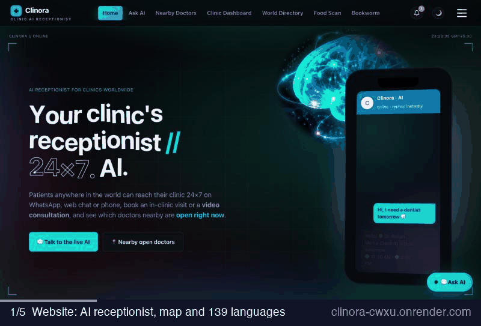

*By Ram Mukesh Yadav, B.Tech CSE at NIT Srinagar. Live demo: [clinora-cwxu.onrender.com](https://clinora-cwxu.onrender.com) · Code: [github.com/urstrulyrammukesh/clinora](https://github.com/urstrulyrammukesh/clinora)*

In a lot of India, finding a doctor still means asking around, waiting in a queue you can't see, and losing paper prescriptions. I wanted one place where a patient can find a real doctor, book a slot, have a video visit, get a prescription that turns into reminders, and keep their reports safe.

That became **Clinora**. And because it holds health data, I spent as much time trying to break it as building it.

## What it does

- **Patients:** find doctors on a map, book free slots (clinic or video), pay online, get reminders by push, SMS or WhatsApp, and keep **encrypted** health records they share with one doctor for one visit.
- **Doctors:** a public page Google can find, a booking calendar, patient history, earnings and busiest-hours charts, queue tokens with a live tracking link.
- **Everyone:** 139 languages, an installable phone app, and an AI assistant.

## How it's built (on purpose, simply)

- **Python standard library** for the server (`http.server`, `sqlite3`, `hmac`, `hashlib`), so there's very little code I didn't write and can't read.
- **One HTML file, plain JavaScript**, no framework and no build step.
- **SQLite** with 33 tables.
- About **11,000 lines** in total, with 36 end-to-end tests that start a real server.

I built it with an AI pair programmer (Claude Code). I decided the product, tested every flow, and reviewed every change. That made it possible to ship fast. It also made it *more* important to check the security myself, which is the part of this post I'm proudest of.

## Then I attacked it

I audited Clinora like an outside tester would: scanners first, then hand checks on the live site.

**Tools:** Bandit (Python code), pip-audit (known vulnerable packages), GitHub CodeQL, and `curl` + a browser.

What I found:

1. **The Content-Security-Policy trusted all of `unpkg.com`.** I only needed one file from it (the map library), but because the whole site was allowed, an injected `<script src="https://unpkg.com/anything">` would have run. **Fix:** allow the exact file, with a Subresource-Integrity hash. I proved it in a browser: the map still loads, while any other unpkg package is now blocked.
2. **The AI chat had no rate limit.** Logins, sign-ups and codes were limited, but each chat message is a paid API call. A script could have run up the bill ("denial of wallet"). **Fix:** 60 messages per visitor per hour.
3. **Vulnerable dependencies:** 8 known advisories in `aiohttp` and `multidict`, pulled in by the push-notification library, which I never imported directly. **Fix:** version floors, plus pip-audit and Dependabot on every push.
4. **Unexpected errors dropped the connection** instead of answering. **Fix:** a plain 500 message for the visitor; details only in the server log, so no stack traces leak.
5. **The rate-limit tables never shrank.** Requests from many IPs could slowly use up memory. **Fix:** they trim themselves.

Plus a missing `Cross-Origin-Opener-Policy`, `file://` hardening and https-only backups. Each fix has a test, so it can't quietly come back. The full report is in [`docs/security-audit.md`](https://github.com/urstrulyrammukesh/clinora/blob/main/docs/security-audit.md).

## The parts that were already right

- Passwords: PBKDF2-SHA256 with 310,000 rounds and a salt per user; lockout after 8 failed logins.
- Every page gets a fresh CSP nonce, and the code has no inline `onclick=`.
- Payment and WhatsApp webhooks are checked with HMAC signatures.
- Health records are encrypted with AES-256-GCM, with the record id bound in, so files can't be swapped.
- Another patient's record returns **404, not 403**, so you can't even learn that it exists.

I wrote these up as a **STRIDE threat model** ([`docs/threat-model.md`](https://github.com/urstrulyrammukesh/clinora/blob/main/docs/threat-model.md)): for each kind of attack, what it targets and which layer stops it.

## Two things I'd tell other students

1. **Attack your own project before you show it to anyone.** Scanners took minutes and found real issues. The most important finding (the AI bill) came from simply listing every costly action and asking "what limits this?"
2. **Free hosting has traps.** On Render's free plan the disk is wiped on every deploy. Instead of paying straight away, I made Clinora upload a last backup when the host stops it and restore it on an empty disk, with a test that proves it.

## What's next

Two-factor login for clinic admins, a custom domain behind Cloudflare, and a pilot with real clinics.

If you're working on health tech or security, I'd love feedback: the code is open, and there's a private way to report vulnerabilities in [SECURITY.md](https://github.com/urstrulyrammukesh/clinora/blob/main/SECURITY.md).
