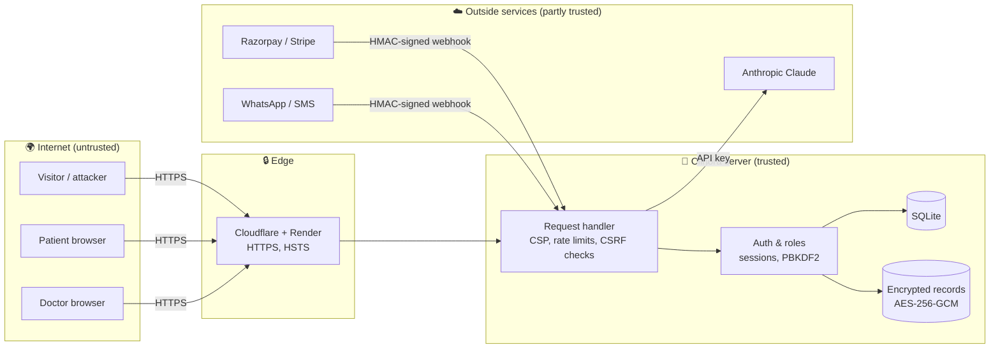

# Clinora threat model (STRIDE)

Who might attack Clinora, what they would go after, and which layer stops them. Written with the **STRIDE** method: **S**poofing, **T**ampering, **R**epudiation, **I**nformation disclosure, **D**enial of service, **E**levation of privilege.

## What we protect

| Asset | Why it matters |
|---|---|
| Health records and prescriptions | Most sensitive data: medical history |
| Accounts (patients, doctors, admins) | Taking one over means reading or changing the above |
| Bookings and payments | Money moves between patients and doctors |
| The AI assistant | Every message costs money |
| The server and database | Holds everything |

## Trust boundaries

Every arrow that crosses a box is a **trust boundary**: data crossing it is checked before it's used.

## Threats and defences

| STRIDE | Threat | Example attack | Defence in Clinora |
|---|---|---|---|
| **S**poofing | Log in as someone else | Password guessing | PBKDF2 (310k rounds), 8 failures → 15-minute lock |
| | Fake a doctor | Sign up claiming to be a doctor | Registration number + admin verification, "verified" badge only after review |
| | Fake a payment | Send a made-up "payment done" message | Razorpay/Stripe webhooks verified with HMAC signatures |
| | Steal a session | Read the cookie with injected script | `HttpOnly` cookie, strict CSP with nonce |
| **T**ampering | Change someone's booking | Send their booking id to the API | Every query checks the owner (`member_id = me`) |
| | Change a health file on disk | Edit the stored file | AES-256-**GCM**: any change makes decryption fail |
| | Inject SQL | `' OR 1=1 --` in a form | All visitor input goes through `?` placeholders |
| **R**epudiation | "I never cancelled that visit" | Deny an action | Bookings, reports, payouts and admin actions are stored with time and user |
| **I**nformation disclosure | Read another patient's record | Guess `/api/m/records/file/42` | Owner check; strangers get **404** (can't even tell it exists) |
| | Cross-site scripting | `<script>` in a review | Output escaped; CSP blocks injected scripts; uploads type-checked |
| | Leak through errors | Trigger a crash to see file paths | Plain 500 message; details only in the server log |
| | Snoop the network | Public Wi-Fi | HTTPS everywhere, HSTS for a year |
| **D**enial of service | Flood sign-ups / codes / chat | Script thousands of requests | Per-IP and per-user rate limits on every costly action |
| | Run up the AI bill | Script the chat | 60 AI messages per visitor per hour |
| | Exhaust memory | Requests from many addresses | Rate tables trim themselves; request bodies have size limits |
| **E**levation of privilege | Patient becomes admin | Call admin APIs | Role checked on every admin route; first admin needs a one-time setup code |
| | Clickjacking | Hide Clinora in an invisible frame | `X-Frame-Options: DENY`, `frame-ancestors 'none'` |
| | Load attacker's script | Point a script tag at a CDN | CSP allows only exact files, with Subresource Integrity |

## What's left (accepted or planned)

| Risk | Plan |
|---|---|
| Admin account taken over with a stolen password | Two-factor login for admins |
| Big, spread-out traffic floods | Cloudflare rate rules / WAF once on a custom domain |
| Server compromise exposes the records key | Keep `RECORDS_KEY` only in Render's settings; rotate it if leaked |
| Free hosting loses data on redeploy | Cloud backups + automatic restore ([persistence](go-live.md)) |

See the [security audit](security-audit.md) for what was tested and fixed.
